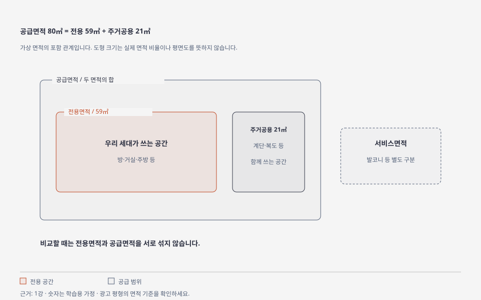

# 1강 — 집·면적·거래 방식

[이전: 0강](00-start-here.md) · [전체 순서](../README.md) · [다음: 2강](02-price-and-rent.md)

## 목표

매물 한 줄을 읽고 **무슨 집을, 어떤 방식으로, 얼마에 거래하는지** 설명합니다.

## 그림으로 이해하기

도형은 가상 면적의 포함 관계이며 실제 평면도나 면적 비율이 아닙니다. [크게 보기](../visuals/html/01-area.html) · [그림 모음](../visuals/README.md)

## 쉬운 설명

부동산은 땅과 건물처럼 위치를 옮길 수 없는 재산입니다. 이 교재에서는 사람이 사는 주택부터 다룹니다. 집의 종류를 말하는 것과 그 집에 사는 계약 방식을 말하는 것은 다릅니다.

| 구분 | 뜻 | 먼저 볼 것 |
|---|---|---|
| 아파트 | 공동주택의 한 유형 | 단지·동·호수·면적·연식 |
| 연립·다세대 | 아파트와 다른 공동주택 유형 | 건축물대장상 유형·호별 권리 |
| 다가구 | 건축법상 단독주택 유형으로 여러 가구가 살 수 있음 | 건물 전체 권리와 다른 임차인의 보증금 |
| 오피스텔 | 업무시설 분류가 기본인 건축물 | 공적 서류에 적힌 용도와 실제 사용, 제도별 주택 판정 |

일상에서 쓰는 `빌라`는 법적 유형 하나를 정확히 가리키는 말이 아닙니다. 다가구와 다세대도 이름이 비슷하므로 서류에서 구분합니다. 오피스텔의 세금·청약상 취급은 제도별로 확인합니다.

| 거래 방식 | 무엇을 하는가 | 돈의 성격 |
|---|---|---|
| 매매 | 소유권을 사고파는 거래 | 집을 취득하는 대금 |
| 전세 | 큰 보증금을 맡기고 계약 기간 동안 거주 | 나중에 반환받을 보증금 |
| 월세 | 보증금과 정기 임대료를 내고 거주 | 반환 대상 보증금 + 매달 지출 |
| 분양 | 새 주택 등의 공급 계약을 체결 | 계약금·중도금·잔금 등 |

## 면적 읽기

**전용면적**은 한 세대가 전용으로 쓰는 면적입니다. **공급면적**은 전용면적에 주거공용면적을 합한 것입니다. 발코니 등 서비스면적은 별도로 구분되므로 광고 숫자와 실제 체감 크기가 다를 수 있습니다.

1평은 약 3.3058㎡입니다. `84㎡ ÷ 3.3058 ≈ 25.4평`은 전용면적의 환산입니다. 광고에서 흔히 부르는 평형은 공급면적 기준일 수 있으므로 `전용 84㎡`와 `25평형`을 같은 말로 단정하지 않습니다.

## 가격 읽기

- **호가:** 파는 사람 또는 임대인이 광고에 제시한 가격
- **실거래가:** 실제 체결되어 신고된 거래의 가격
- **공시가격:** 공적 목적에 사용하는 별도의 평가 가격

어느 숫자인지 적지 않으면 서로 다른 기준을 비교하게 됩니다.

## 가상 사례와 실습

가상 A단지의 광고가 `매매 6억원, 전용 59㎡, 공급 80㎡`라면 집을 사는 거래이며 전용과 공급 숫자는 서로 다른 면적입니다. 실거래가가 6억원이라는 사실은 아직 확인되지 않았습니다.

0강에서 본 매물을 다음 문장으로 바꿔 쓰세요.

> 이 매물은 ______에 있는 ______ 유형이며, ______ 방식이다. 광고 가격은 ______이고 전용면적은 ______이다. 실제 계약 가격과 권리관계는 ______이다.

## 확인 문제

1. 전세 보증금은 집의 소유권을 사는 대금인가요?
2. 같은 84㎡라도 전용과 공급이 섞여 있으면 그대로 비교해도 되나요?
3. 매물에 `빌라`라고 쓰였으면 건축물대장 확인을 생략해도 되나요?

해설

1. 아닙니다. 거주 계약에 따라 반환받을 보증금입니다.
2. 면적 기준을 통일해야 합니다.
3. 건축물대장에서 실제 유형과 용도를 확인해야 합니다.

## 출처와 다음 단계

유형의 법적 분류는 [국가법령정보센터](https://www.law.go.kr/)의 건축법 시행령 별표 1, 가격 자료의 구분은 [국토부 공개 안내](https://rt.molit.go.kr/pt/info/info.do)를 참고합니다. [출처 목록](../sources/catalog.md)의 S01·S09를 보세요. 다음 강의에서는 보증금·월세·이자를 비교합니다.
