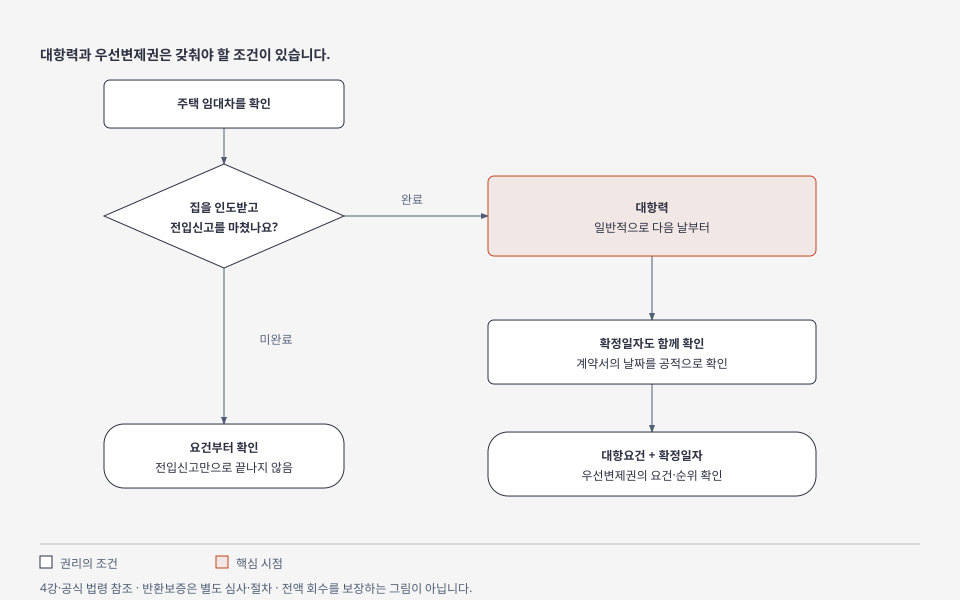

# 4강 — 집의 서류와 보증금 보호

[이전: 3강](03-budget-and-loans.md) · [전체 순서](../README.md) · [다음: 5강](05-data-and-market.md)

## 목표

집의 상태를 확인하는 서류와 계약상 권리를 확인하는 서류를 구분합니다. 보증금을 보호하는 장치가 각각 무엇을 하는지 설명합니다.

## 그림으로 이해하기

일반적인 개념 흐름입니다. 개별 권리 순위와 반환보증 조건은 아래 설명과 공식 원문을 함께 확인합니다. [크게 보기](../visuals/html/04-lease-rights.html) · [그림 모음](../visuals/README.md)

## 쉬운 설명

자동차를 볼 때 실제 차와 등록 서류를 함께 확인하듯, 집도 현장과 서류를 함께 봅니다. 광고 사진으로 소유자나 담보 권리를 알 수는 없습니다.

| 서류 | 무엇을 확인하나 | 핵심 구분 |
|---|---|---|
| 등기사항증명서 | 부동산의 표시, 소유권, 담보 등 권리 | 표제부·갑구·을구 |
| 건축물대장 | 건물의 용도·면적·사용승인 등 | 광고와 공적 서류의 용도·면적이 맞는지 |
| 토지이용계획확인서 | 토지의 용도지역·지구 등 제한 | 개발 기대와 실제 허용 조건 |
| 임대차계약서 | 당사자·목적물·보증금·기간·특약 | 서류와 실제 거래가 일치하는지 |

등기의 **표제부**는 어떤 부동산인지, **갑구**는 소유권 관련 사항, **을구**는 소유권 외의 권리입니다. 압류·가압류·신탁 등 갑구 사항도 확인해야 합니다. 을구가 비어 있다고 모든 위험이 사라지는 것은 아닙니다.

압류·가압류는 채권 회수 등을 위해 재산 처분을 제한하는 절차이고, 신탁은 재산을 수탁자에게 맡겨 관리·처분하도록 하는 제도입니다. 표시가 있으면 계약 권한과 영향을 추가 확인합니다. **인도**는 집을 넘겨받아 점유하는 것, **말소**는 관련 등기를 지우는 처리입니다.

**근저당권**은 일정 범위의 채무를 담보하는 권리입니다. **채권최고액**은 담보되는 최고 한도이지, 현재 대출 잔액과 같은 숫자가 아닙니다. 실제 잔액, 권리 순서, 말소 조건을 따로 확인합니다.

## 세 가지 보호 장치

| 장치 | 쉬운 설명 | 오해하지 말 것 |
|---|---|---|
| 대항력 | 집주인이 바뀌는 등 제3자에게 임대차를 주장하는 힘 | 전입신고만으로 모든 요건이 끝나는 것은 아님 |
| 우선변제권 | 경매·공매에서 후순위 권리자보다 보증금을 우선 배당받을 권리 | 경매대금 부족 등으로 전액 회수가 안 될 수 있음 |
| 반환보증 | 정해진 보증 조건과 절차에 따라 보증기관에 이행을 청구하는 제도 | 신청·승인·유지·이행 조건을 각각 확인 |

주택임대차에서 일반적으로 **주택의 인도와 주민등록**을 갖추면 다음 날부터 대항력이 생깁니다. 확정일자는 계약서의 날짜를 공적으로 확인하는 장치이며, 대항요건과 함께 우선변제권에 연결됩니다. 확정일자만 받아 놓으면 보증금이 자동으로 전액 보장되는 구조가 아닙니다. 실제 순위·요건은 권리 발생 시점별로 확인합니다.

## 가상 사례: 숫자 하나로 안전 판정하지 않기

가상 집의 예상 매매가격이 5억원, 등기상 채권최고액이 3억원, 내 보증금이 2억원이라고 합시다.

`3억원 + 2억원 = 5억원`이라는 계산만으로 계약 가능 여부를 판단할 수 없습니다. 매매가격 추정이 맞는지, 실제 채무가 얼마인지, 다른 임차인·조세채권·권리 순서가 어떠한지, 경매 시 얼마가 남을지를 확인해야 합니다. 다가구는 다른 임차인의 보증금과 순위도 중요한 확인 대상입니다.

반환보증은 가입 가능 여부뿐 아니라 승인 상태, 보증금액, 보증기간, 면책·이행 조건도 봅니다. 전세대출 보증과 전세보증금 반환보증은 보호하는 대상과 목적이 다를 수 있습니다.

## 계약 시점별로 확인하기

1. 계약 전: 등기·건축물대장·현장·임대인 권한·보증 조건을 확인합니다.
2. 계약과 잔금 사이: 합의한 권리 정리·대출·보증 절차가 진행되는지 확인합니다.
3. 잔금 시: 최신 권리 상태와 말소·인도 조건을 다시 확인합니다.
4. 입주 후: 인도·전입 처리·확정일자·보증 승인 상태를 확인하고 증빙을 보관합니다.
5. 종료 시: 보증금 반환과 이사 일정을 함께 정합니다. 미반환이면 이사·전출 전에 임차권등기명령 등 권리 유지 절차를 검토합니다. **신청과 등기 완료는 다른 단계**입니다.

이 목록은 공부할 순서입니다. 개별 권리 충돌은 서류와 날짜를 대조해 추가 확인합니다.

## 실습과 확인 문제

실제 계약서 대신 가상 사례를 사용해 아래 질문에 답해 보세요.

1. 등기 소유자와 계약 상대방이 다르면 무엇을 확인해야 하나요?
2. 채권최고액 2억원이면 현재 대출 잔액도 2억원인가요?
3. 계약이 끝났는데 보증금을 못 받았습니다. 전출부터 해도 되나요?

해설

1. 계약 권한, 위임 및 관련 증빙을 확인해야 합니다. 단순히 가족이라는 설명으로 끝내지 않습니다.
2. 최고 담보 한도와 실제 채무는 다릅니다.
3. 기존 권리 유지에 영향을 줄 수 있으므로, 임차권등기의 완료 여부 등 필요한 절차를 먼저 확인합니다.

## 출처

- [생활법령정보: 등기 구조](https://www.easylaw.go.kr/CSP/CnpClsMainBtr.laf?ccfNo=1&cciNo=2&cnpClsNo=1&csmSeq=566)
- [생활법령정보: 대항력·우선변제권](https://www.easylaw.go.kr/CSP/CnpClsMainBtr.laf?ccfNo=2&cciNo=3&cnpClsNo=1&csmSeq=629)
- [생활법령정보: 임차권등기명령](https://www.easylaw.go.kr/CSP/CnpClsMainBtr.laf?ccfNo=5&cciNo=2&cnpClsNo=1&csmSeq=629)
- [HUG: 전세보증금반환보증](https://www.khug.or.kr/khmb/m/hg/gg/hggg000002_0.jsp)

2026-10-13 확인. S08~S12의 자세한 확인 범위는 [출처 목록](../sources/catalog.md)에 기록했습니다.
