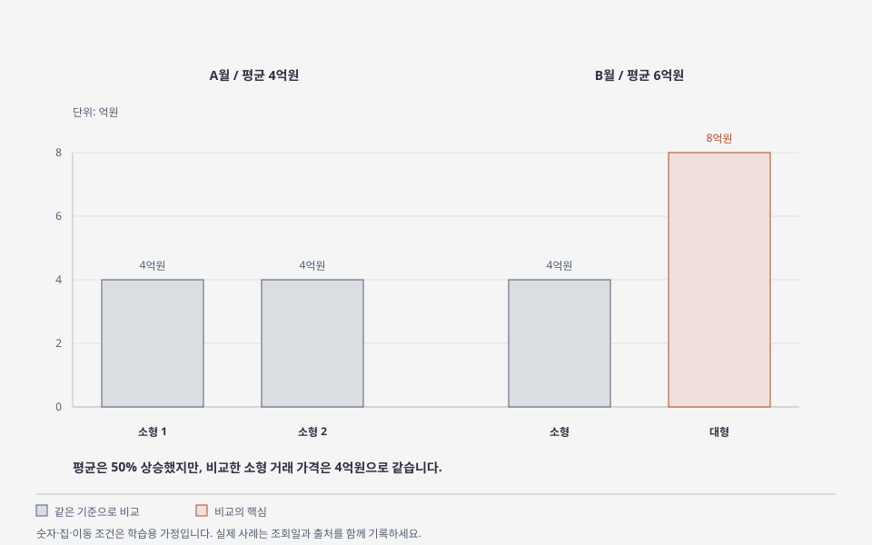

# 5강 — 실거래가와 시장 데이터 읽기

[이전: 4강](04-documents-and-lease.md) · [전체 순서](../README.md) · [다음: 6강](06-location-and-visit.md)

## 목표

숫자를 볼 때 **어느 지역·어떤 집·언제·몇 건·무슨 기준인지** 함께 확인합니다.

## 그림으로 이해하기

소형 가격이 그대로여도 대형 거래가 섞이면 평균은 오를 수 있습니다. [크게 보기](../visuals/html/05-average-trap.html) · [그림 모음](../visuals/README.md)

## 쉬운 설명

실거래가는 개별 계약의 결과, 가격지수는 시장의 변화 방향을 요약하는 지표입니다. 호가는 거래를 희망하는 가격입니다. 이 셋은 역할이 다릅니다.

| 자료 | 답하는 질문 | 주의할 점 |
|---|---|---|
| 호가 | 지금 얼마에 내놓았나? | 실제 체결 가격이 아닐 수 있음 |
| 실거래가 | 얼마에 계약되었나? | 면적·층·시점·거래 유형·해제 확인 |
| 가격지수 | 표본 또는 정해진 방법으로 본 시장은 어떻게 변했나? | 지역 평균을 개별 집에 그대로 적용하지 않기 |
| 거래량 | 얼마나 거래되었나? | 계약일·신고일, 신고 지연, 정정·해제 |
| 입주 물량 | 언제 거주 가능한 집이 늘어날 예정인가? | 계획·예정·실제 입주 구분 |
| 미분양 | 공급했지만 분양되지 않은 물량은 얼마인가? | 준공 전·준공 후와 지역 구분 |

한국부동산원의 주택가격동향조사와 공동주택 실거래가격지수는 별도 통계입니다. 지수 기준시점이 100이라는 것은 그때를 비교 기준으로 삼았다는 뜻이며 가격이 100만원이라는 뜻이 아닙니다. 서로 다른 기준시점의 지수 수준을 그대로 비교하지 않습니다.

## 평균가격이 오르면 같은 집도 오른 것일까

학습용 가상 거래입니다.

| 기간 | 거래 1 | 거래 2 | 평균 |
|---|---:|---:|---:|
| A월 | 소형 4억원 | 소형 4억원 | 4억원 |
| B월 | 소형 4억원 | 대형 8억원 | 6억원 |

평균은 50% 올랐지만 소형 집의 가격은 그대로입니다. 거래된 집의 구성이 달라졌기 때문입니다. 같은 단지·같은 면적에 가까운 거래끼리 먼저 비교해야 하는 이유입니다.

## 계약일과 신고일 구분

국토부의 조건별 실거래 자료는 계약일 기준입니다. 7월 계약을 8월에 신고해도 7월 계약 자료로 들어갑니다. 주택 매매 신고에는 계약 후 신고 기간이 있고, 해제·정정으로 자료가 바뀔 수 있습니다. 현재 진행 중인 달과 집계가 더 쌓인 과거 달을 바로 비교하면 거래 급감을 과장할 수 있습니다.

이 자료로 세는 학습용 계약 건수와 신고일 기준 공식 거래통계를 구분합니다. 보고서에는 사용한 기준과 조회일을 적고, 공식 통계로 표현할 때는 해당 공식 집계를 사용합니다.

## 실습: 한 단지에서 5건 찾기

1. [국토부 실거래 조회](https://rt.molit.go.kr/pt/gis/gis.do?srhThingSecd=A) 또는 조건별 자료제공을 엽니다.
2. 서울·경기의 익숙한 단지 하나를 정합니다.
3. 같은 거래 방식·같은 전용면적 기준으로 최근 6~12개월을 봅니다.
4. [실거래 기록 양식](../templates/transaction-log.md)에 5건을 적습니다. 5건이 안 나오면 기간을 넓히거나 `자료 부족`으로 남깁니다.
5. 해제된 거래를 구분하고 층·거래 유형·시점을 함께 비교합니다.
6. 호가 1개를 따로 적고, 실거래와의 차이를 계산합니다. 그 차이를 곧바로 할인 가능 금액으로 단정하지 않습니다.

자동 수집이 필요해지는 후속 작업에서는 공공데이터포털의 공식 API와 이용 조건을 먼저 검토합니다. 이 교재의 첫 실습은 수동 조회입니다.

## 확인 문제

1. 서울 가격지수가 0.2% 상승했다면 모든 단지가 0.2% 올랐나요?
2. 이번 달 신고된 거래가 적다는 이유만으로 수요가 급감했다고 할 수 있나요?
3. 평균가격이 올랐을 때 추가로 무엇을 보나요?

해설

1. 지역 지수의 변화이며 개별 단지의 변화와 다를 수 있습니다.
2. 집계 기준·신고 지연·계절 요인과 이전 기간을 확인해야 합니다.
3. 면적·단지·층 등 거래 구성, 비교 가능한 거래 수, 해제 여부를 봅니다.

## 출처

[국토부 자료 이용 시 유의사항](https://rt.molit.go.kr/pt/xls/xls.do), [해제 표시가 있는 조회 화면](https://rt.molit.go.kr/pt/gis/gis.do?srhThingSecd=A), [공개 안내](https://rt.molit.go.kr/pt/info/info.do), [R-ONE](https://www.reb.or.kr/r-one/portal/main/indexPage.do), [한국부동산원 주택가격조사 안내](https://www.reb.or.kr/reb/cm/cntnts/cntntsView.do?cntntsId=1170&mi=9788). S01~S03은 [출처 목록](../sources/catalog.md)에 있습니다. 평균 사례는 가상입니다.
