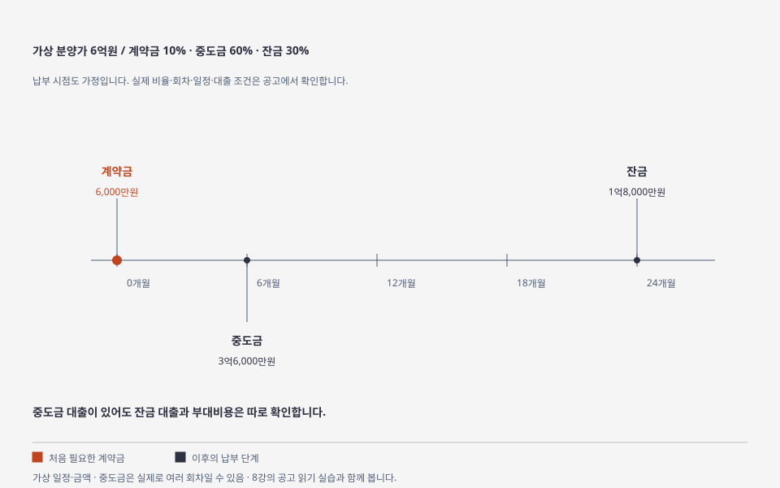

# 8강 — 청약과 공공임대 공고 읽기

[이전: 7강](07-seoul-gyeonggi.md) · [전체 순서](../README.md) · [다음: 9강](09-purchase-and-tax.md)

## 목표

공고 하나에서 **신청할 수 있는지, 언제 신청하는지, 얼마가 필요한지**를 찾습니다.

## 그림으로 이해하기

금액·비율·일정은 가정입니다. 실제 중도금 회차와 대출·납부 조건은 공고를 읽습니다. [크게 보기](../visuals/html/07-payment-timeline.html) · [그림 모음](../visuals/README.md)

## 쉬운 설명

청약은 공급되는 주택에 신청하는 절차입니다. 분양 청약과 임대주택 신청은 얻는 권리와 비용이 다릅니다. 같은 신혼부부·생애최초라는 이름도 공급 유형과 공고에 따라 요건이 다를 수 있습니다.

| 구분 | 무엇을 얻는 계약인가 | 먼저 읽을 것 |
|---|---|---|
| 민영·공공 분양 | 주택을 취득하는 공급 계약 | 신청 자격, 선정 방식, 계약·중도금·잔금 |
| 공공임대 | 일정 조건으로 거주하는 임대 계약 | 자격, 보증금·임대료, 기간·갱신 조건 |
| 분양전환 임대 | 임대 후 조건에 따라 분양전환 여부·조건이 정해지는 유형 | 전환 가능 여부, 시기, 가격 산정과 자격 |

`공공임대`라고 모두 나중에 소유권을 얻는 것은 아닙니다. 공고에서 유형과 조건을 확인합니다. 당첨은 자격 확인과 계약·대금 납부가 남아 있는 단계일 수 있습니다.

## 공고 읽는 순서

1. 공급기관·공고일·정정공고·주택 위치·공급 유형을 확인합니다.
2. 신청 자격을 봅니다: 무주택, 세대 구성, 거주지역·기간, 통장, 소득·자산 등 공고가 요구하는 항목입니다.
3. 자격을 판단하는 기준일과 소득·자산 산정 기준을 찾습니다.
4. 일반·특별공급 또는 임대 대상 유형별 선정 방식을 확인합니다.
5. 접수·발표·서류·계약·대금·입주 일정을 시간순으로 적습니다.
6. 분양대금 또는 보증금·임대료, 옵션·보증·관리 비용과 자금 조달을 봅니다.
7. 적용되는 전매제한·거주의무·재당첨제한·갱신 조건 등을 공고에서 확인합니다.

모든 항목이 모든 유형에 같은 방식으로 적용되는 것은 아닙니다. 해당하지 않는 항목은 `해당 없음`, 확인할 수 없는 항목은 `미확인`으로 표시합니다.

전매제한은 정한 기간에 다시 파는 것을 제한하는 조건, 거주의무는 정한 기간 직접 거주해야 하는 조건, 재당첨제한은 정한 범위와 기간에 다른 주택의 당첨을 제한하는 조건입니다. 적용 여부와 기간은 공고에서 찾습니다.

## 가상 사례: 당첨 이후의 돈

가상 분양가격 6억원, 납부 비율을 계약금 10%·중도금 60%·잔금 30%로 가정합니다.

| 단계 | 가정 금액 | 추가 질문 |
|---|---:|---|
| 계약 | 6,000만원 | 계약일까지 현금을 마련할 수 있나? |
| 중도금 | 3억6,000만원 | 납부 회차와 대출 가능 여부는? |
| 잔금 | 1억8,000만원 | 중도금 대출 상환·전환과 별도 잔금을 합쳐 마련할 수 있나? |

이 비율은 모든 분양의 규정이 아닙니다. 세금·옵션·중도금 이자·등기·이사 비용도 별도로 봅니다. 중도금 대출이 있다고 잔금 대출까지 보장되는 것은 아닙니다.

## 실습

[청약홈](https://www.applyhome.co.kr/)의 분양 공고 또는 [마이홈](https://m.myhome.go.kr/hws/mbl/main/mblMainPage.do)의 임대 공고 하나를 고릅니다. 검색 목록에서 실제 공급기관의 최신 원문과 정정공고로 이동해 [공고 읽기 양식](../templates/notice-review.md)을 채웁니다. 마이홈 집계 화면에는 수집 시점 차이가 있을 수 있습니다.

서울은 SH, 경기는 GH·LH 등 공급기관의 해당 공고도 확인합니다. 학습할 때는 신청 버튼을 누를 필요가 없습니다.

## 확인 문제

1. 무주택이면 모든 공공임대에 신청 가능한가요?
2. 신혼부부라는 상태만으로 특별공급 자격이 확정되나요?
3. 분양가와 현금 필요액은 같은 숫자인가요?

해설

1. 공급 유형별 소득·자산·세대·거주 등 조건을 함께 확인합니다.
2. 공고의 정의와 기준일, 다른 자격 요건을 확인해야 합니다.
3. 단계별 대금, 대출 실행·상환, 부대비용 때문에 다릅니다.

## 출처

[한국부동산원 청약홈 안내](https://www.reb.or.kr/), [마이홈 공고 조회](https://m.myhome.go.kr/hws/portal/sch/selectRsdtRcritNtcView.do), [LH 청약플러스](https://apply.lh.or.kr/), [GH](https://www.gh.or.kr/), [SH](https://www.i-sh.co.kr/). 포털과 공고의 확인 범위는 [출처 목록](../sources/catalog.md) S15~S18을 참고하세요. 개인별 자격 판정과 최신 수치표는 작성하지 않았습니다.
