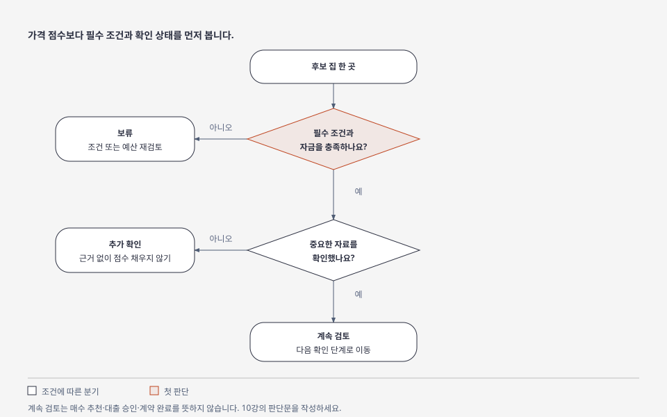

# 10강 — 집 3개를 비교하고 판단문 쓰기

[이전: 9강](09-purchase-and-tax.md) · [전체 순서](../README.md) · [진도 기록](../PROGRESS.md)

## 목표

조사한 근거로 **선택·보류·추가 확인**을 구분합니다. 목표 결과물은 집을 반드시 계약하는 것이 아니라 이유를 설명할 수 있는 비교표 한 장입니다.

## 그림으로 이해하기

그림은 조사 상태를 구분합니다. 매수 추천이나 계약 완료 판정이 아닙니다. [크게 보기](../visuals/html/08-decision.html) · [그림 모음](../visuals/README.md)

## 쉬운 설명

여러 집을 비교할 때는 사실, 가정, 아직 모르는 것을 구분해야 합니다. 점수표는 생각을 정리하는 도구입니다. 자금이나 권리 문제를 높은 입지 점수로 상쇄할 수는 없습니다.

## 종합 과제

1. 서울·경기 생활권 3곳에서 단지 1개씩 고릅니다.
2. 같은 거래 형태와 필요한 면적 범위를 설정합니다.
3. [실거래 기록](../templates/transaction-log.md), [단지 비교표](../templates/apartment-comparison.md), [예산표](../templates/budget.md)를 작성합니다.
4. 단지 1곳 이상을 방문하고 [현장 기록](../templates/site-visit.md)을 남깁니다.
5. 각 후보에 아래 상태를 표시합니다.

| 판단 | 의미 |
|---|---|
| 계속 검토 | 필수 조건을 만족하며 다음 확인을 진행할 수 있음 |
| 보류 | 필수 조건 미충족 또는 감당할 자금 부족 |
| 추가 확인 | 중요한 자료가 없어 판단을 완료할 수 없음 |

`계속 검토`는 대출 승인·법률 검토·계약 완료의 뜻이 아닙니다.

## 가상 시나리오 계산

가상 매매가격 6억원, 대출 3억원으로 취득하면 초기 주택 순자산은 부대비용을 제외하고 3억원입니다. 집값만 10% 내려 5억4,000만원이 되고 대출 잔액을 그대로 3억원으로 가정하면 순자산은 2억4,000만원입니다. 집값은 10% 내려도 주택 순자산은 20% 줄어듭니다.

순자산 변화와 월 상환 가능성은 다른 문제입니다. 다음 상황도 따로 계산합니다.

- 대출 금리 4%에서 6%로 변화: 3강의 월 상환액 비교
- 주거비 납부 전 가처분 현금 250만원에서 200만원으로 감소
- 전세 종료 시 보증금 반환이 늦어지는 경우: 이사·권리 유지·자금 일정
- 주변 입주가 늘거나 교통 계획이 늦어지는 경우: 현재 조건으로 계속 생활 가능한지

위 10%·4%·6%·현금 금액은 시장 전망이 아니라 연습 조건입니다.

## 판단문 양식

> 나의 목적은 ______이고, 필수 조건은 ______이다. A·B·C를 ______ 기준으로 비교했다. 현재 확인한 사실은 ______이다. A는 ______ 때문에 계속 검토한다. B는 ______ 때문에 보류한다. C는 ______ 자료가 없어 추가 확인한다. 금리·소득이 불리하게 변할 때 ______가 달라진다. 다음 확인은 ______이다.

출처와 조회일을 적습니다. 실제 개인 자금이나 계약 상대방 정보는 공개 판단문에 넣지 않습니다.

## 확인 문제

1. 입지 점수가 가장 높으면 자금 부족 후보도 선택해도 되나요?
2. 가격 하락에 따른 순자산 변화와 월 상환 부담은 같은 계산인가요?
3. 자료가 없는 항목은 평균 점수를 넣는 것이 좋나요?

해설

1. 필수 조건과 자금 문제를 먼저 봅니다.
2. 자산·부채의 평가와 현금 흐름은 구분해야 합니다.
3. `미확인`으로 남기고 추가 확인합니다. 근거 없는 점수는 결론을 왜곡할 수 있습니다.

## 출처와 이후 학습

비교 틀과 가상 계산은 이 교재에서 작성했습니다. 실제 자료는 [공식 자료 목록](../sources/catalog.md)의 해당 출처를 사용합니다. 끝났다면 [진도 기록](../PROGRESS.md)을 갱신하고 [확장 순서](../ROADMAP.md)의 정비사업·투자수익·개별 자산 공부로 이동합니다.
