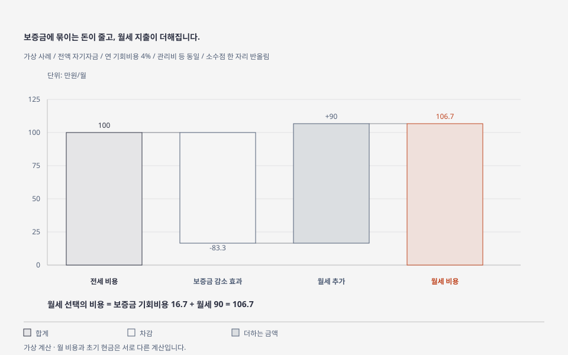
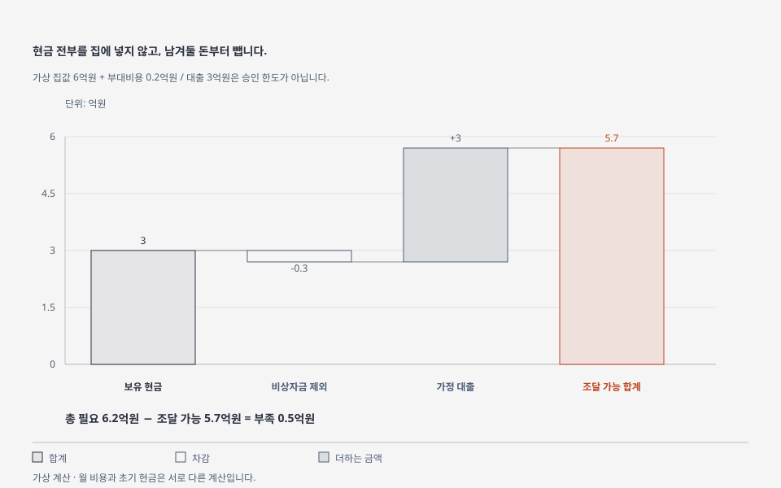
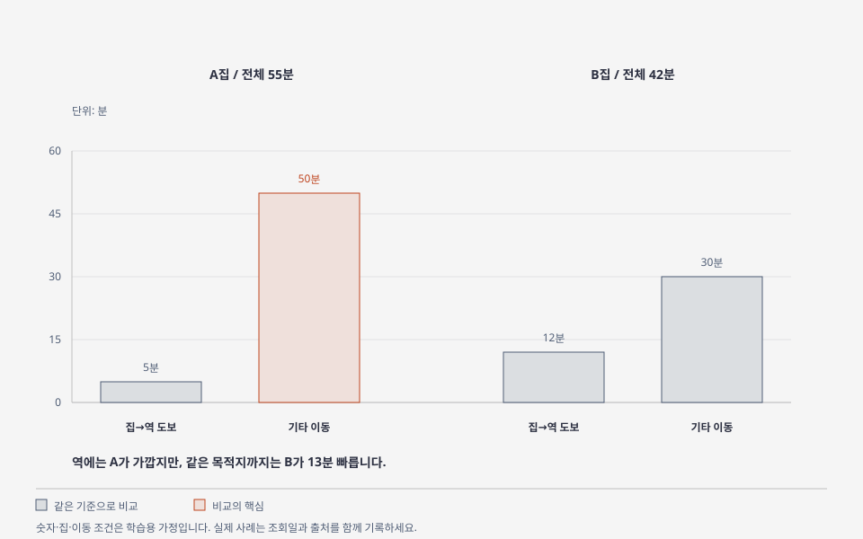

# 처음 배우는 부동산 — 그림으로 이해하기

[교재 목록](../README.md) · [한 파일로 모아 보기](index.html) · [제작 방식](DESIGN.md)

한 그림에 한 가지 개념을 담았습니다. GitHub에서는 아래 SVG가 바로 표시됩니다. HTML은 파일을 내려받아 브라우저에서 열면 크게 볼 수 있습니다. `index.html`에는 8개 그림이 모두 들어 있어 그 파일 하나로 전체 그림을 읽을 수 있습니다.

숫자·면적·이동시간·납부 일정은 **가상 예제**입니다. 법률 그림은 일반적인 요건을 설명하며 실제 계약의 권리 순위를 판정하지 않습니다. 각 강의에서 설명·실습·해설·공식 출처를 함께 읽습니다.

## 그림 목록

| 그림 | 익힐 개념 | 연결 강의 | HTML |
|---|---|---|---|
| 01 | 전용면적과 공급면적의 포함 관계 | [1강](../lessons/01-basics.md) | [보기](html/01-area.html) |
| 02 | 보증금 기회비용과 월세를 더한 비교 | [2강](../lessons/02-price-and-rent.md) | [보기](html/02-rent-cost.html) |
| 03 | 비상자금을 남기고 조달 자금 계산 | [3강](../lessons/03-budget-and-loans.md) | [보기](html/03-cash-budget.html) |
| 04 | 대항력·확정일자·우선변제권의 조건 | [4강](../lessons/04-documents-and-lease.md) | [보기](html/04-lease-rights.html) |
| 05 | 거래 구성으로 평균이 바뀌는 사례 | [5강](../lessons/05-data-and-market.md) | [보기](html/05-average-trap.html) |
| 06 | 역까지 거리와 전체 출퇴근 시간의 차이 | [6강](../lessons/06-location-and-visit.md) | [보기](html/06-commute.html) |
| 07 | 분양대금의 시점별 납부 | [8강](../lessons/08-subscription-and-public-housing.md) | [보기](html/07-payment-timeline.html) |
| 08 | 계속 검토·보류·추가 확인의 분기 | [10강](../lessons/10-capstone.md) | [보기](html/08-decision.html) |

## 01 — 전용·공급·서비스면적

도형의 크기는 면적 비율이나 실제 평면도가 아닙니다. 광고의 전용·공급 기준을 먼저 확인합니다.

## 02 — 전세와 월세의 비용

기회비용은 계좌에서 매달 빠져나가는 돈과 다릅니다. 대출을 사용하면 실제 이자와 자기자금의 기회비용을 나눠 계산합니다.

## 03 — 조달 가능 자금

가상 집값과 부대비용 합계는 6.2억원이므로 5,000만원이 부족합니다. 대출액은 승인된 한도가 아닙니다.

## 04 — 보증금 보호의 조건

대항력·우선변제권·반환보증은 역할과 조건이 다릅니다. 전입·확정일자·보증으로 모든 보증금이 자동 보호되는 것은 아닙니다. 자세한 요건과 출처는 [4강](../lessons/04-documents-and-lease.md)을 봅니다.

## 05 — 평균가격의 착시

평균 50% 상승이라는 숫자만으로 같은 집이 50% 올랐다고 볼 수 없습니다.

## 06 — 전체 출퇴근 시간

같은 목적지와 시간대를 기준으로 대기·환승·마지막 도보까지 합산합니다.

## 07 — 분양대금의 납부 시점

0·6·24개월은 학습용 가정입니다. 중도금은 실제 공고에서 여러 회차로 나뉠 수 있으며 잔금 대출과 비용도 별도로 확인합니다.

## 08 — 판단의 분기

`계속 검토`는 계약하거나 매수하라는 결론이 아닙니다. 자료를 바탕으로 다음 확인을 진행한다는 뜻입니다.

## 디자인 출처

사용한 스킬: [cathrynlavery/diagram-design](https://github.com/cathrynlavery/diagram-design) · [읽은 SKILL.md](https://github.com/cathrynlavery/diagram-design/blob/0a8ea20ae69b33a5edce6018eedd3a9d26e90c1c/skills/diagram-design/SKILL.md).

의존 관계보다 포함 관계·숫자 비교·판단 분기가 중요한 내용을 골라 Nested·Waterfall·Bar·Timeline·Flowchart 유형을 적용했습니다. 라이선스는 [THIRD_PARTY_NOTICES.md](THIRD_PARTY_NOTICES.md)에 수록했습니다.
